<div align="center">

<picture>
  <source media="(prefers-color-scheme: dark)" srcset="docs/brand/svg/matcms-logo-dark.svg" />
  
</picture>

**Websites, blogs and shops. In one container.**

A self-hosted, block-based CMS: build pages from blocks, publish in several languages, blog and sell –
no plugin zoo, no database server. One Docker container, one volume, one SQLite file.

[matcms.de](https://matcms.de) · [Quick start](#quick-start) · [Cloud](#cloud)

</div>

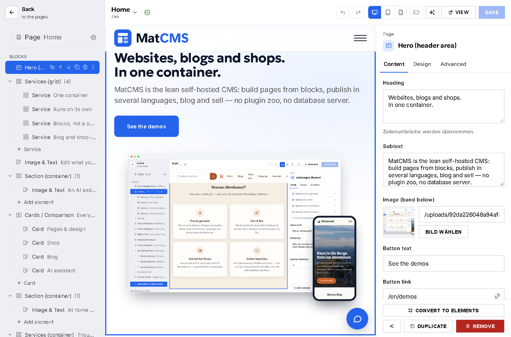

---

## What this is about

Most content systems are either a database monster with a plugin zoo or a builder that outgrows you
after the first client. MatCMS sits in between: an **ASP.NET Core application in exactly one Docker
container** that assembles a website from **blocks** – with a real live preview, templates, forms, a
blog, a shop, an AI assistant and full multilingual support.

**MatCMS runs on its own.** No account with us, no mandatory cloud, no third-party services – fonts
are served by your own server, AI is optional and uses your own key. One instance = one website;
several websites run as several containers and can, if you want, be watched and updated centrally
from the optional [cloud control plane](#cloud).

## At a glance

**Pages & content**
- **Page editor** with a block tree, drag & drop, undo/redo and the **real page** as preview –
  desktop, tablet and phone; texts are typed straight into the preview
- **Over 35 block types** (hero, image & text, cards, bento grid, timeline, testimonials, pricing,
  comparison, gallery with lightbox, FAQ, form, embed …), nestable in sections and columns, plus your
  own **components** with a field designer
- **Multi-level menus** with visibility per audience (everybody / signed-in members / guests)
- **Media library** with crop, resize, focal point, in-place editing (every page using the picture
  follows), SVG support and "used on" lookup

**Blog & shop – built in, not bolted on**
- **Blog** with tags, teasers, an overview page and the `posts` block
- **Shop** (switch it on when you need it): categories as a tree, attributes and filters, variants with
  their own stock, coupons, **Stripe**, **PayPal** and prepayment, customer accounts, downloads,
  **PDF invoices and credit notes**, VAT by country incl. **EU OSS** – and every shop page is laid out
  in the block editor like any other page

**AI – optional, your choice of provider**
- **AI assistant** in the back office: say in plain words what should change, it reads the site,
  plans, builds with the same blocks you use, shows every step and can be **undone** per request
- **AI bot** for visitors, answering from your pages, posts and products – with limits, consent
  dialog and no access to anybody else's data
- Connect **your own key** (OpenAI-compatible, e.g. DeepSeek, Mistral, OpenRouter), a **ChatGPT
  account**, or the cloud's relay – several profiles side by side, one active

**Forms**
- **Visual form builder** with live preview: text, email, choice, groups, conditions, an image picker
  and a date / date-range picker
- Spam protection in levels (invisible, proof-of-work, captcha), notifications, an inbox for all
  submissions

**Multilingual**
- A separate page / form version **per language**, `/{lang}/…` addresses, a language switcher
- A field-level **translation diff**: what is translated, what is missing, click to edit

**Design & templates**
- **Templates** with a designer (colours, fonts, buttons, header) and their files (layout, CSS,
  article, login, maintenance page) – five included
- Fonts are fetched once by the server and served locally: **no visitor is ever sent to Google**

**Plugins**
- **Script plugins** (C#, edited in the browser with completion and a compile check) and **native
  plugins** (compiled DLLs, off unless the operator allows them) – one API for both: routes, admin
  pages, blocks, settings, data tables, jobs, events, mail templates, menu elements
- Import/export as bundles; the cloud's store offers ready-made ones

**Back office**
- Built on **MatUi**: compact, light / dark / system per user, a configurable **dashboard**, lists
  that become cards on a phone
- Installable as an **app (PWA)** with an offline page and reconnect handling
- **Two-factor sign-in (TOTP)** with recovery codes, users & roles, members area for visitors
- Visitor **statistics** without cookies, error log, cleanup of unused media and plugins

**Operations**
- **Backup / restore**, selective or complete, scheduled, optionally pushed to the cloud
- **One container, one volume** – database, keys, uploads and backups live in `/app/appdata`
- Database changes are **EF migrations** applied at start – an update never touches your content

## Screenshots

### Dashboard

| Light | Dark |
|---|---|
| 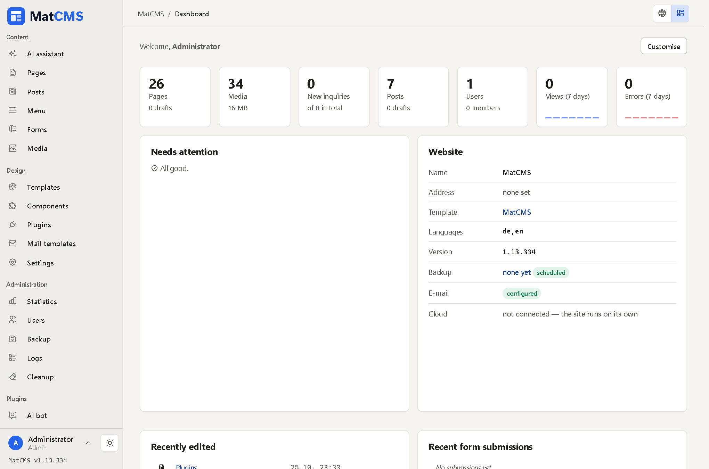 | 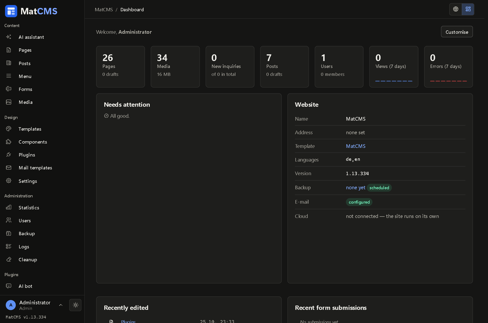 |

Tiles, what needs attention, the state of the site, recently edited – and every widget can be moved or
hidden ("Customise").

### Block picker

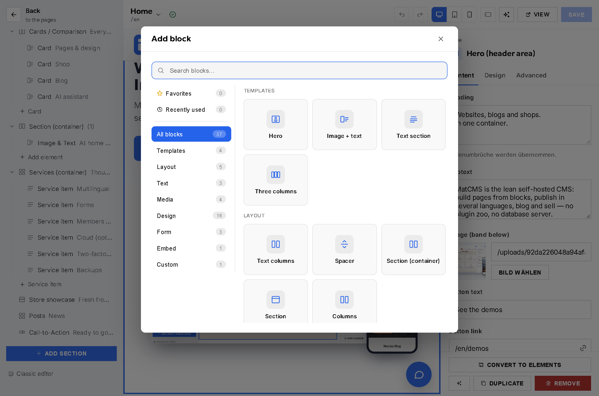

### AI assistant

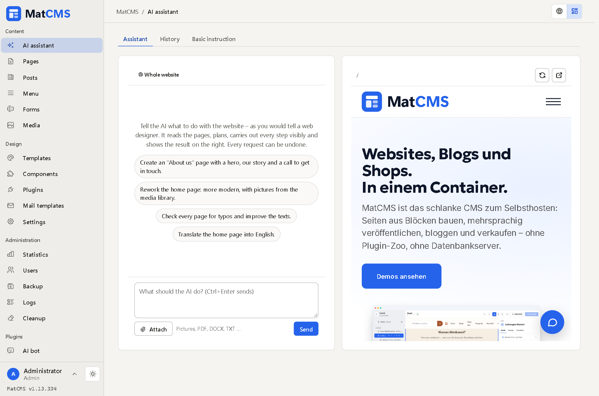

### Forms, templates, media

| Form builder | Templates | Media |
|---|---|---|
| 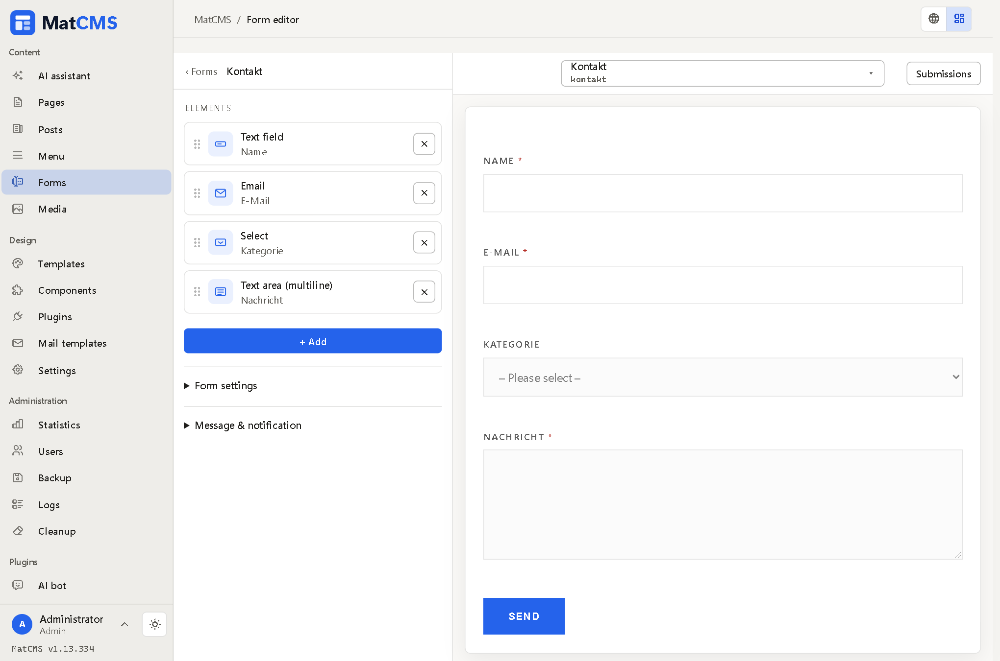 | 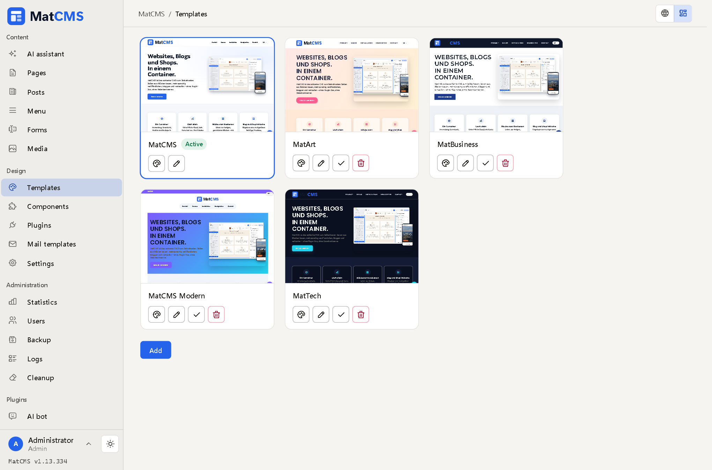 | 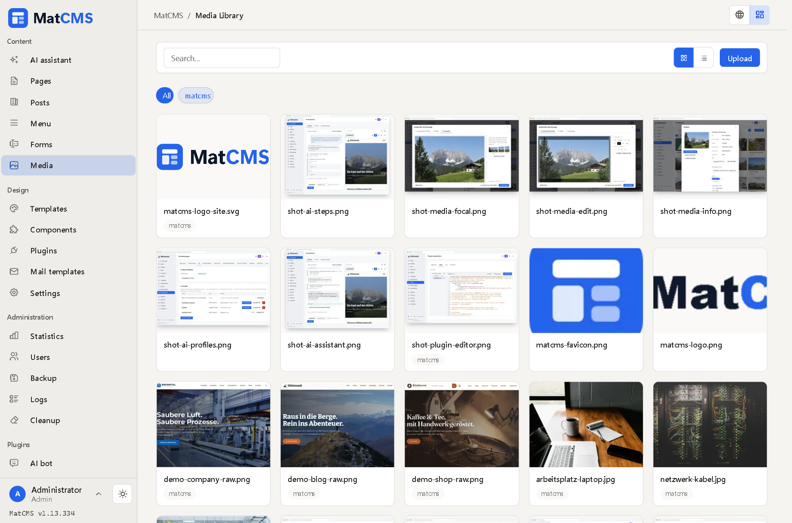 |

### The public site

| Home page | Contact form |
|---|---|
| 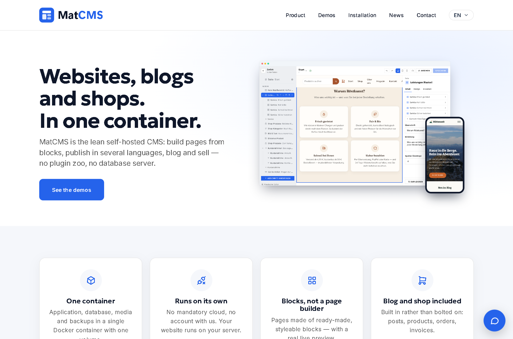 | 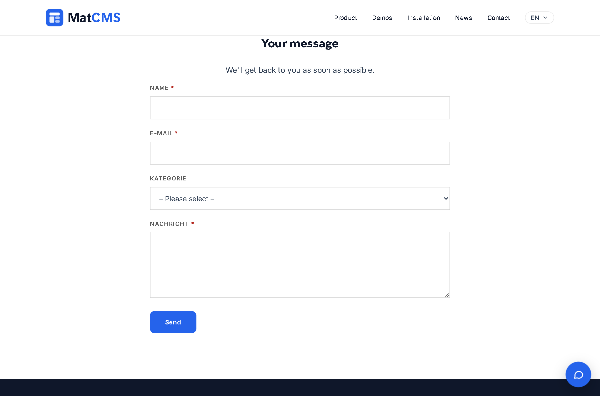 |

### On a phone

| Website | Form | Back office | Menu |
|---|---|---|---|
| 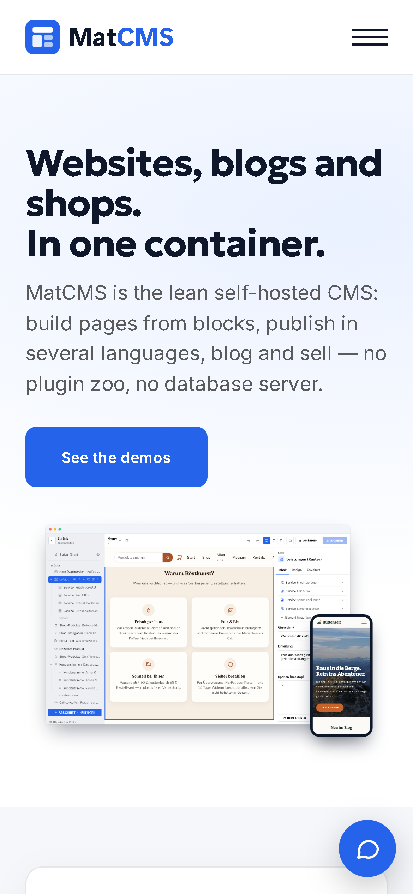 | 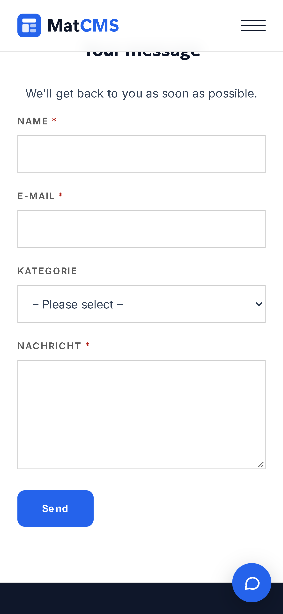 | 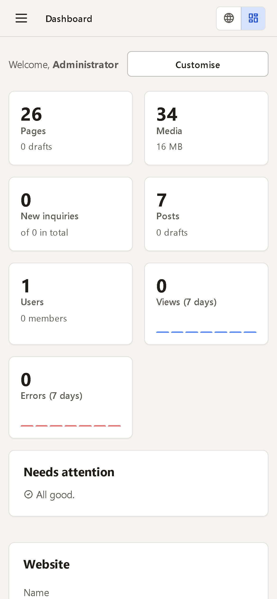 | 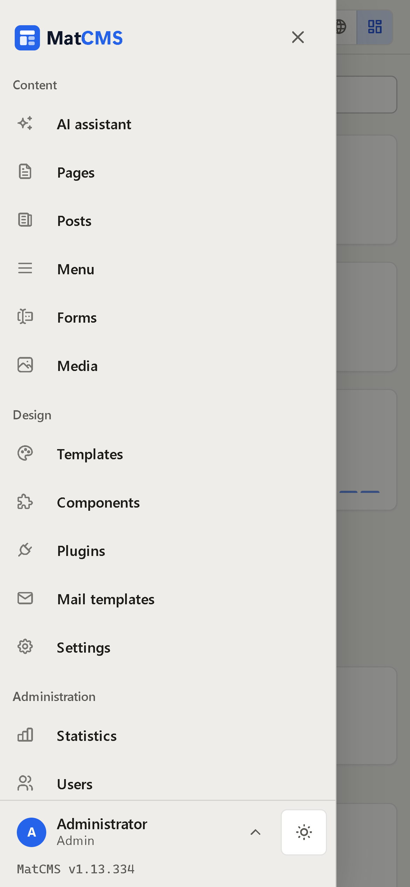 |

The screenshots show [matcms.de](https://matcms.de) itself – the product's website is built with MatCMS.

## Quick start

Ready-made images are published to the GitHub Container Registry:

| Tag | Built from | Use it for |
|---|---|---|
| `ghcr.io/real-ttx/matcms:latest` | `main` | releases |
| `ghcr.io/real-ttx/matcms:nightly` | `dev` | the newest features |

`docker-compose.yml`:

```yaml
services:
  matcms:
    image: ghcr.io/real-ttx/matcms:latest
    container_name: matcms
    restart: unless-stopped
    ports:
      - "9101:8080"
    volumes:
      - matcms-data:/app/appdata   # DB, keys, uploads, backups – everything lives here

volumes:
  matcms-data:
```

```bash
docker compose up -d
```

Open **http://localhost:9101** and sign in with **`admin` / `admin`** – the setup wizard then walks you
through the admin account, theme, e-mail and the first page. An update afterwards is just
`docker compose pull && docker compose up -d`; the volume keeps content, settings and keys.

## Cloud

**MatCMS.Cloud** is the optional control plane for many self-hosted sites. A site connects to it, and
from then on the cloud can:

- **watch versions** centrally and **update** sites at a click (with rollback), the cloud itself too
- **notify** by e-mail (site offline, new version, failed update) – per user and per site
- **roll out profiles**: settings, users, plugins, components, templates, mail templates, backup plans
- **keep backups** off-site with quota and retention, restore them, move a site between hosts
- **host** sites: create containers, publish domains through Caddy / Matcad, wildcard certificates,
  further Docker hosts as nodes
- offer **single sign-on** into every site, a **store** of templates and plugins, an **AI relay**,
  visitor statistics of all sites – and every capability also as **REST API** and **MCP server**

→ **Full docs: [src/MatCMS.Cloud/README.md](src/MatCMS.Cloud/README.md)**
(image `ghcr.io/real-ttx/matcms-cloud`, port `9100`).

## Monorepo

Two applications, one repo, a shared stack – developed in lockstep:

| Project | What it is | Port | Image |
|---|---|---|---|
| [`src/MatCMS`](src/MatCMS) | The CMS | 9101 | `ghcr.io/real-ttx/matcms` |
| [`src/MatCMS.Cloud`](src/MatCMS.Cloud) | The control plane | 9100 | `ghcr.io/real-ttx/matcms-cloud` |
| [`src/MatCMS.Shared`](src/MatCMS.Shared) | The cloud ↔ site contract, 2FA, AI clients, statistics | – | – |
| [`src/MatCMS.Shared.Web`](src/MatCMS.Shared.Web) | The shared back office: MatUi, CSS, scripts, editors, PWA | – | – |
| [`src/MatCMS.Plugin.Abstractions`](src/MatCMS.Plugin.Abstractions) | The API plugins are written against | – | – |
| [`plugins/`](plugins) | Sources of the store plugins | – | – |

### Build & run

```bash
cd src/MatCMS       && docker compose up -d --build   # → http://localhost:9101
cd src/MatCMS.Cloud && docker compose up -d --build   # → http://localhost:9100
```

Locally with hot reload (.NET SDK 10): `./run-dev.ps1` in either folder. Everything at once:
`dotnet build MatCMS.slnx`; tests: `dotnet test tests/MatCMS.Plugins.Tests`.

### Stack

ASP.NET Core 10 · Razor Pages · C# (`net10.0`) · SQLite via EF Core (with migrations) · Docker-first ·
no SPA framework, no Node build chain.

### CI/CD

Four workflows in `.github/workflows/`, two per application; the **`paths:` filters** make sure a CMS
change does not build a cloud image and vice versa (the shared projects build both):

| Workflow | Builds | Trigger |
|---|---|---|
| `release.yml` / `dev.yml` | `matcms` | `src/MatCMS/**` and the shared projects |
| `cloud-release.yml` / `cloud-dev.yml` | `matcms-cloud` | `src/MatCMS.Cloud/**` and the shared projects |

Versions are `MAJOR.MINOR` from the project's `VERSION` file plus the run number.

## Brand

The logo "Blöcke" in every variant (light, dark, white, site header, mark, cloud; SVG and PNG) is in
[`docs/brand`](docs/brand).
